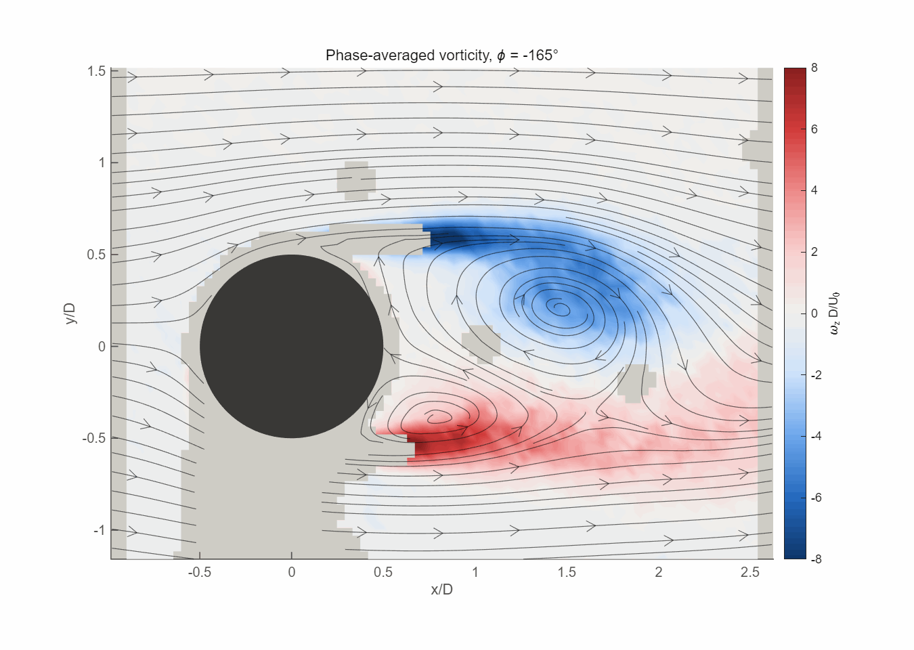
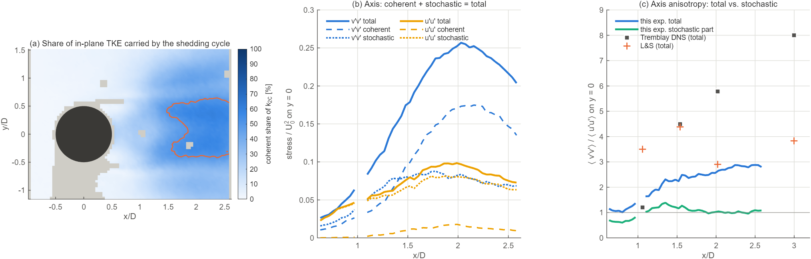

# Cylinder-wake PIV analysis · 圆柱尾迹 PIV 数据分析 · PIV-Auswertung des Zylindernachlaufs

MATLAB code for the full post-processing of a planar PIV measurement of the wake behind a circular cylinder in an open water channel: calibration, outlier filtering, mean and turbulence statistics, POD, phase averaging, vortex tracking, discharge estimation, a check of the unknown frame rate, and a comparison with Tremblay's (2001) DNS/LES at Re = 3900.

一套 MATLAB 代码，用于明渠中圆柱尾迹的平面 PIV 数据后处理。内容包括：标定、坏矢量剔除、时均与湍流统计、POD、相位平均、涡追踪、流量估算、未知采样率的检验，以及与 Tremblay（2001）Re = 3900 DNS/LES 结果的对比。

MATLAB-Code für die vollständige Auswertung einer ebenen PIV-Messung im Nachlauf eines Kreiszylinders in einem offenen Wasserkanal: Kalibrierung, Ausreißerfilterung, mittlere Strömung und Turbulenzstatistik, POD, Phasenmittelung, Wirbelverfolgung, Bestimmung des Durchflusses, Prüfung der unbekannten Bildrate und Vergleich mit der DNS/LES von Tremblay (2001) bei Re = 3900.

<p align="center">
  
  
</p>

**Contents · 目录 · Inhalt**
[中文说明](#中文说明) · [English](#english) · [Deutsch](#deutsch) · [Repository layout · 仓库结构 · Aufbau](#repository-layout--仓库结构--aufbau)

---

## 中文说明

### 1. 需要什么

| 项目 | 说明 |
|---|---|
| MATLAB | R2020a 或更新版本（用到 `tiledlayout`、`exportgraphics`）；在 R2025b 上测试通过 |
| 工具箱 | Image Processing Toolbox（`imgaussfilt`、`regionfill`）；Statistics and Machine Learning Toolbox（`prctile`、`quantile`、`corr`） |
| 数据 | 课程提供的 PIV 数据集 `FM-Lab-WS2627-Group1`，**不包含在仓库里**，目录结构见 [`data/README.md`](data/README.md) |
| 内存 | 约 4 GB 可用内存。有圆柱的数据有 4069 个 64 × 86 位移场，空水槽有 690 个 |

### 2. 快速开始

```matlab
% 1) 克隆仓库后，把数据放到 data/FM-Lab-WS2627-Group1/
%    （或者用环境变量指定数据所在位置）
setenv('PIV_DATA', 'D:/path/to/FM-Lab-WS2627-Group1');   % 可选
setenv('PIV_RESULTS', 'D:/path/to/results');             % 可选，默认 results/

% 2) 在仓库根目录运行完整流程（普通台式机约 3 分钟）
run_all

% 3) 只重跑某一步（前面的步骤已经生成了所需的 .mat 文件）
run_step('s6_flowrate_timing')
```

结果写到 `results/`：中间量为 `.mat` 文件，图片在 `results/figures/`。

### 3. 处理流程

| 步骤 | 脚本 | 做什么 | 读入 | 输出 |
|---|---|---|---|---|
| 1 | `s1_calibration.m` | 用 11 张粒子图像的平均图找圆柱轮廓（中间无粒子）做圆拟合，得到放大率的初步估计 0.0915 mm/px。无粒子圆盘（351 px）比标定图上的亮环（376.9 px）小，边缘不清楚，所以只作对照，最终采用 s1b | `Samples/*.TIF` | `calibration.mat` |
| 1b | `s1b_ring.m` | 在标定图上拟合被照亮的圆柱边缘亮环，给出 s2 使用的圆心和直径（376.9 px → 0.0853 mm/px） | `Calibration/*.TIF` | 屏幕输出 |
| 2 | `s2_process.m` | 位移转速度 u = dispX·M/Δt；三级坏矢量剔除；时均、雷诺应力、偏度、涡量、湍动能生成 | `Data/PIV_Data_Cyl.mat` | `cyl_stats.mat`、`cyl_velocity.mat` |
| 4 | `s4_analysis.m` | 空水槽来流、中心线与剖面、回流区长度 L<sub>r</sub>、快照 POD、按 POD 相位做 12 区间相位平均、频谱 | `PIV_Data_Bulk.mat`、上一步结果 | `analysis.mat` |
| 5 | `s5_figures.m` | 基本图 F01–F16 及相位动画 | 上述结果 | `figures/F01…F16` |
| 6 | `s6_flowrate_timing.m` | 由空水槽剖面积分求流量 Q（Monte Carlo 不确定度）；检验采样率假设，计算 Strouhal 数 | `analysis.mat` | `flowrate_timing.mat`、F17、F18 |
| 7 | `s7_literature.m` | 与 Tremblay（2001）对比；三重分解、涡追踪与环量、脱涡间歇性、条件平均、上下不对称 | 上述结果、`lit_tremblay.m` | `literature.mat` |
| 9 | `s9_review_check.m` | 复核计算：涡的运动方向（确定混叠符号）、L<sub>r</sub> 收敛、耗散率、流量敏感性、来流湍流度 | 上述结果 | `review_check.mat` |
| 8 | `s8_lit_figures.m` | 对比图 L01–L03 与新分析图 N01–N06（需要 s9 的结果，所以在 s9 之后运行） | 上述结果 | `figures/L0*, N0*` |
| 10 | `s10_fs_scenario.m` | 采样频率取 1 Hz 与 2 Hz 时各结果的对比 | 上述结果 | `figures/N07` |

`src/explore/` 里是探索性脚本（来流剖面初看、剖面拟合、TIF 元数据），不属于主流程。

### 4. 实验参数与假设

| 量 | 值 | 来源 |
|---|---|---|
| 圆柱直径 D | 32.15 mm | 记录表 |
| 两次曝光间隔 Δt | 3000 µs | 数据集 |
| 放大率 M | 0.0853 mm/px（D = 376.9 px） | 标定图亮环拟合（s1b） |
| 矢量网格 | 86 × 64，间距 16 px = 0.042 D | 数据集（32 px 判读窗，50 % 重叠） |
| 水深 y<sub>0</sub> | 0.118 m | 记录表 |
| 槽宽 b | **0.060 m** | 实验者更正（记录表上写的 0.60 m 有误） |
| 圆柱中心离槽底 | 约 60 mm | 实验者提供 |
| 水温、ρ、ν | 23.8 °C，997.3 kg/m³，9.17 × 10⁻⁷ m²/s | 记录表 |
| 示踪粒子 | d<sub>p</sub> = 50 µm，ρ<sub>p</sub> = 1016 kg/m³ | 记录表 |
| 采样频率 f<sub>s</sub> | **1 Hz，未核实** | 实验者的估计。所有用到“秒”的量（脱涡频率、Strouhal 数、涡的推进速度）都依赖它 |

改用其他数据时需要修改的常数：

- `s2_process.m`：`D_mm`、`Dpx`、`xc_px`、`yc_row`（圆柱直径与圆心像素位置）、`nu`、`rho`。
- `s6_flowrate_timing.m`、`s9_review_check.m`：`b`、`h`（槽宽、水深），以及 `cases` 里的槽底位置。
- `s10_fs_scenario.m`：`frac`（相邻样本的相位步长对应的 f/f<sub>s</sub>）和 `ub`。
- `lit_tremblay.m`：对比用的文献数据（目测数字化，精度约 ±0.02）。

### 5. 主要方法

- **速度与坏矢量。** u = dispX·M/Δt。剔除分三级：位移超过 8 px；偏离该点时间序列中值 6 倍稳健标准差；Westerweel–Scarano（2005）通用异常检测（3 × 3，阈值 2，ε = 0.1 px）。剔除后不替补。统计量只在有效率 ≥ 50 % 的点上计算。
- **POD 与相位。** 快照 POD（SVD），缺失点用 `regionfill` 补。相位 φ = atan2(a<sub>2</sub>/√(2λ<sub>2</sub>), a<sub>1</sub>/√(2λ<sub>1</sub>))，振幅 A > 0.5 的帧参加 12 区间相位平均。
- **三重分解。** u = U + ũ + u″，即时均、相干（相位平均减时均）和随机三部分。
- **涡识别。** 旋转强度 λ<sub>ci</sub>，在 λ<sub>ci</sub> > 0.15 max 的区域内积分环量 Γ，并逐相位追踪涡核。
- **采样率与混叠。** 数据不是时间解析的：相邻样本的相位步长圆均值为 −172.1°。涡核随 φ 增大向上游移动，所以物理时间沿 −φ 方向，f/f<sub>s</sub> = n + 0.478。取 n = 0、f<sub>s</sub> = 1 Hz 时，阻塞修正后的 Strouhal 数为 0.206；按 Strouhal 数 0.18–0.24 反推，f<sub>s</sub> 应在 0.87–1.16 Hz 之间。2 Hz 给出 Strouhal 数 0.41，与数据不相容。
- **流量 Q。** 视场内对实测剖面积分；槽底间隙用 1/m 幂律（m = 3–10）；顶部间隙外推；侧壁修正 κ<sub>w</sub> = m<sub>w</sub>/(m<sub>w</sub>+1)（60 mm 槽宽中两侧边界层在中线相遇）。用 2 × 10⁵ 次 Monte Carlo 估计不确定度。
- **耗散率与 Stokes 数。** 记录表公式 ε ≈ u<sub>b</sub>³/D，与由数据估计的 ε（2/3 律、0.5u″³/L<sub>11</sub>）并列给出。Stokes 数 = τ<sub>p</sub>/τ<sub>η</sub>。

### 6. 主要结果（本数据集）

| 量 | 值 |
|---|---|
| 流量 Q | 0.384 l/s（95 %：0.364–0.402） |
| 断面平均流速 u<sub>b</sub>，Re<sub>D</sub> | 0.0542 m/s，约 1900（阻塞修正后约 2600） |
| 回流区长度 L<sub>r</sub>（从后缘算） | 1.39 D；文献实验值 1.4 ± 0.1 |
| POD 模态 1 + 2 能量 | 39.7 % |
| Strouhal 数（阻塞修正） | 0.206，前提是 f<sub>s</sub> = 1 Hz 且 n = 0 |
| 中心线上相干部分占法向应力的比例 | 约 54 % |

### 7. 已知局限

- **采样率未知。** f<sub>s</sub> = 1 Hz 只是一致性检验，不是证明。如果知道 4069 帧实际录了多长时间，就能直接确定。
- **Peak locking。** 位移的概率密度在整像素处有尖峰，rms 值有偏差；时均值基本不受影响。
- **缺失矢量与相位有关。** 剪切层里有效率随相位在 0.52–0.66 之间变化，相位平均和 rms 可能偏低。
- **端壁。** 圆柱展长只有 1.87 D，两端是侧壁，与文献的周期展向不同。PIV 平面在中线，与文献的比较只针对这一截面。
- **文献曲线。** `lit_tremblay.m` 里的曲线是目测数字化的，精度约 ±0.02。

---

## English

### 1. Requirements

| Item | Notes |
|---|---|
| MATLAB | R2020a or newer (`tiledlayout`, `exportgraphics`); tested on R2025b |
| Toolboxes | Image Processing Toolbox (`imgaussfilt`, `regionfill`); Statistics and Machine Learning Toolbox (`prctile`, `quantile`, `corr`) |
| Data | The course dataset `FM-Lab-WS2627-Group1`, **not included in this repository**; see [`data/README.md`](data/README.md) for the expected layout |
| Memory | About 4 GB free. The cylinder dataset holds 4069 displacement fields of 64 × 86 vectors, the empty-channel dataset 690 |

### 2. Quick start

```matlab
% 1) After cloning, put the data in data/FM-Lab-WS2627-Group1/
%    (or point to it with an environment variable)
setenv('PIV_DATA', 'D:/path/to/FM-Lab-WS2627-Group1');   % optional
setenv('PIV_RESULTS', 'D:/path/to/results');             % optional, default results/

% 2) From the repository root, run the whole pipeline (about 3 min on a desktop PC)
run_all

% 3) Re-run a single step (earlier steps must already have written their .mat files)
run_step('s6_flowrate_timing')
```

Results go to `results/`: intermediate quantities as `.mat` files, figures in `results/figures/`.

### 3. Pipeline

| Step | Script | What it does | Reads | Writes |
|---|---|---|---|---|
| 1 | `s1_calibration.m` | Mean of 11 particle images shows the cylinder as a particle-free disc; a circle fit gives a first estimate of 0.0915 mm/px. The particle-free disc (351 px) is smaller than the illuminated rim on the calibration image (376.9 px) and its edge is blurred, so this is only a cross-check and s1b is used | `Samples/*.TIF` | `calibration.mat` |
| 1b | `s1b_ring.m` | Circle fit to the illuminated rim on the calibration image; gives the centre and diameter used in s2 (376.9 px → 0.0853 mm/px) | `Calibration/*.TIF` | console |
| 2 | `s2_process.m` | Displacement to velocity, u = dispX·M/Δt; three-stage outlier removal; means, Reynolds stresses, skewness, vorticity, TKE production | `Data/PIV_Data_Cyl.mat` | `cyl_stats.mat`, `cyl_velocity.mat` |
| 4 | `s4_analysis.m` | Empty-channel inflow, centreline and profiles, recirculation length L<sub>r</sub>, snapshot POD, 12-bin phase averaging on the POD phase, spectra | `PIV_Data_Bulk.mat`, step-2 results | `analysis.mat` |
| 5 | `s5_figures.m` | Basic figures F01–F16 and the phase animation | results above | `figures/F01…F16` |
| 6 | `s6_flowrate_timing.m` | Discharge Q from the empty-channel profile with Monte Carlo uncertainty; check of the frame-rate assumption and the Strouhal number | `analysis.mat` | `flowrate_timing.mat`, F17, F18 |
| 7 | `s7_literature.m` | Comparison with Tremblay (2001); triple decomposition, vortex tracking and circulation, shedding intermittency, conditional averages, top/bottom asymmetry | results above, `lit_tremblay.m` | `literature.mat` |
| 9 | `s9_review_check.m` | Cross-checks: vortex travel direction (fixes the alias sign), L<sub>r</sub> convergence, dissipation rate, discharge sensitivity, inflow turbulence | results above | `review_check.mat` |
| 8 | `s8_lit_figures.m` | Comparison figures L01–L03 and new-analysis figures N01–N06 (needs s9, so it runs after it) | results above | `figures/L0*, N0*` |
| 10 | `s10_fs_scenario.m` | Side-by-side results for f<sub>s</sub> = 1 Hz and 2 Hz | results above | `figures/N07` |

`src/explore/` holds exploratory scripts (first look at the inflow, profile-law fits, TIF metadata) that are not part of the pipeline.

### 4. Parameters and assumptions

| Quantity | Value | Source |
|---|---|---|
| Cylinder diameter D | 32.15 mm | worksheet |
| Pulse separation Δt | 3000 µs | dataset |
| Magnification M | 0.0853 mm/px (D = 376.9 px) | circle fit to the illuminated rim (s1b) |
| Vector grid | 86 × 64, spacing 16 px = 0.042 D | dataset (32 px windows, 50 % overlap) |
| Water depth y<sub>0</sub> | 0.118 m | worksheet |
| Channel width b | **0.060 m** | corrected by the experimenter (the worksheet's 0.60 m is wrong) |
| Cylinder centre above the bed | about 60 mm | given by the experimenter |
| Water temperature, ρ, ν | 23.8 °C, 997.3 kg/m³, 9.17 × 10⁻⁷ m²/s | worksheet |
| Tracer particles | d<sub>p</sub> = 50 µm, ρ<sub>p</sub> = 1016 kg/m³ | worksheet |
| Frame rate f<sub>s</sub> | **1 Hz, unverified** | the experimenter's estimate. Everything measured in seconds (shedding frequency, Strouhal number, vortex advance speed) depends on it |

Constants to change for another dataset:

- `s2_process.m`: `D_mm`, `Dpx`, `xc_px`, `yc_row` (cylinder diameter and centre in pixels), `nu`, `rho`.
- `s6_flowrate_timing.m`, `s9_review_check.m`: `b`, `h` (width and depth) and the bed positions in `cases`.
- `s10_fs_scenario.m`: `frac` (f/f<sub>s</sub> from the phase step between samples) and `ub`.
- `lit_tremblay.m`: reference curves (digitised by eye, about ±0.02).

### 5. Methods in brief

- **Velocity and outliers.** u = dispX·M/Δt. Three stages: displacement above 8 px; more than 6 robust standard deviations from the local time-series median; the universal outlier detection of Westerweel and Scarano (2005) with a 3 × 3 kernel, threshold 2 and ε = 0.1 px. Removed vectors are not replaced. Statistics are computed only where at least 50 % of the samples are valid.
- **POD and phase.** Snapshot POD by SVD, with gaps filled by `regionfill`. Phase φ = atan2(a<sub>2</sub>/√(2λ<sub>2</sub>), a<sub>1</sub>/√(2λ<sub>1</sub>)); fields with amplitude A > 0.5 enter a 12-bin phase average.
- **Triple decomposition.** u = U + ũ + u″: mean, coherent (phase average minus mean) and stochastic parts.
- **Vortex identification.** Swirling strength λ<sub>ci</sub>; circulation Γ integrated over λ<sub>ci</sub> > 0.15 max, with the cores tracked bin by bin.
- **Frame rate and aliasing.** The data are not time-resolved: the circular-mean phase step between samples is −172.1°. Vortex cores move upstream as φ increases, so physical time runs along −φ and f/f<sub>s</sub> = n + 0.478. With n = 0 and f<sub>s</sub> = 1 Hz, the blockage-corrected Strouhal number is 0.206; a Strouhal number between 0.18 and 0.24 requires f<sub>s</sub> = 0.87–1.16 Hz. At 2 Hz the Strouhal number would be 0.41, which the data rule out.
- **Discharge Q.** Trapezoidal integral of the measured profile inside the field of view; a 1/m power law (m = 3–10) in the gap above the bed; extrapolation to the free surface; side-wall factor κ<sub>w</sub> = m<sub>w</sub>/(m<sub>w</sub>+1), because in a 60 mm channel the two wall layers meet at the centre plane. Uncertainty from 2 × 10⁵ Monte Carlo draws.
- **Dissipation and Stokes number.** The worksheet formula ε ≈ u<sub>b</sub>³/D is reported next to data-based estimates (2/3 law, 0.5u″³/L<sub>11</sub>). Stokes number = τ<sub>p</sub>/τ<sub>η</sub>.

### 6. Main results for this dataset

| Quantity | Value |
|---|---|
| Discharge Q | 0.384 l/s (95 %: 0.364–0.402) |
| Bulk velocity u<sub>b</sub>, Re<sub>D</sub> | 0.0542 m/s, about 1900 (about 2600 blockage-corrected) |
| Recirculation length L<sub>r</sub> (from the rear surface) | 1.39 D; reference experiments 1.4 ± 0.1 |
| Energy of POD modes 1 + 2 | 39.7 % |
| Strouhal number (blockage-corrected) | 0.206, assuming f<sub>s</sub> = 1 Hz and n = 0 |
| Coherent share of the normal stresses on the axis | about 54 % |

### 7. Known limitations

- **Unknown frame rate.** f<sub>s</sub> = 1 Hz passes a consistency check but is not proven. Knowing how long the 4069 fields took to record would settle it.
- **Peak locking.** The displacement PDFs spike at integer pixels, so rms values are biased; means are hardly affected.
- **Phase-dependent dropout.** In the shear layers the valid fraction varies between 0.52 and 0.66 with phase, so phase averages and rms values may be low.
- **End walls.** The cylinder span is only 1.87 D between side walls, unlike the periodic span of the reference simulation. The PIV plane is at mid-span, so the comparison holds for that section only.
- **Reference curves.** The curves in `lit_tremblay.m` are digitised by eye, about ±0.02.

---

## Deutsch

### 1. Voraussetzungen

| Punkt | Hinweise |
|---|---|
| MATLAB | R2020a oder neuer (`tiledlayout`, `exportgraphics`); getestet mit R2025b |
| Toolboxen | Image Processing Toolbox (`imgaussfilt`, `regionfill`); Statistics and Machine Learning Toolbox (`prctile`, `quantile`, `corr`) |
| Daten | Der Kursdatensatz `FM-Lab-WS2627-Group1`, **nicht in diesem Repository enthalten**; die erwartete Ordnerstruktur steht in [`data/README.md`](data/README.md) |
| Arbeitsspeicher | Etwa 4 GB frei. Der Datensatz mit Zylinder enthält 4069 Verschiebungsfelder mit 64 × 86 Vektoren, der Datensatz des leeren Kanals 690 |

### 2. Schnellstart

```matlab
% 1) Nach dem Klonen die Daten nach data/FM-Lab-WS2627-Group1/ legen
%    (oder den Speicherort über eine Umgebungsvariable angeben)
setenv('PIV_DATA', 'D:/path/to/FM-Lab-WS2627-Group1');   % optional
setenv('PIV_RESULTS', 'D:/path/to/results');             % optional, Standard: results/

% 2) Im Wurzelverzeichnis des Repositorys die gesamte Auswertung starten (etwa 3 min auf einem Desktop-PC)
run_all

% 3) Einen einzelnen Schritt erneut ausführen (die vorherigen Schritte müssen ihre .mat-Dateien bereits geschrieben haben)
run_step('s6_flowrate_timing')
```

Die Ergebnisse landen in `results/`: Zwischengrößen als `.mat`-Dateien, Abbildungen in `results/figures/`.

### 3. Ablauf der Auswertung

| Schritt | Skript | Was es tut | Liest | Schreibt |
|---|---|---|---|---|
| 1 | `s1_calibration.m` | Im Mittelwert von 11 Partikelbildern erscheint der Zylinder als partikelfreie Scheibe; eine Kreisanpassung liefert eine erste Schätzung von 0,0915 mm/px. Die Scheibe (351 px) ist kleiner als der beleuchtete Rand im Kalibrierbild (376,9 px) und ihr Rand ist unscharf, daher dient sie nur zum Abgleich; verwendet wird s1b | `Samples/*.TIF` | `calibration.mat` |
| 1b | `s1b_ring.m` | Kreisanpassung an den beleuchteten Zylinderrand im Kalibrierbild; liefert Mittelpunkt und Durchmesser für s2 (376,9 px → 0,0853 mm/px) | `Calibration/*.TIF` | Konsole |
| 2 | `s2_process.m` | Verschiebung in Geschwindigkeit, u = dispX·M/Δt; dreistufige Ausreißerentfernung; Mittelwerte, Reynolds-Spannungen, Schiefe, Wirbelstärke, Produktion der turbulenten kinetischen Energie | `Data/PIV_Data_Cyl.mat` | `cyl_stats.mat`, `cyl_velocity.mat` |
| 4 | `s4_analysis.m` | Anströmung im leeren Kanal, Mittellinie und Profile, Rezirkulationslänge L<sub>r</sub>, Snapshot-POD, Phasenmittelung in 12 Klassen anhand der POD-Phase, Spektren | `PIV_Data_Bulk.mat`, Ergebnisse von Schritt 2 | `analysis.mat` |
| 5 | `s5_figures.m` | Grundlegende Abbildungen F01–F16 und die Phasenanimation | obige Ergebnisse | `figures/F01…F16` |
| 6 | `s6_flowrate_timing.m` | Durchfluss Q aus dem Profil des leeren Kanals mit Monte-Carlo-Unsicherheit; Prüfung der angenommenen Bildrate und der Strouhal-Zahl | `analysis.mat` | `flowrate_timing.mat`, F17, F18 |
| 7 | `s7_literature.m` | Vergleich mit Tremblay (2001); Dreifachzerlegung, Wirbelverfolgung und Zirkulation, Intermittenz der Wirbelablösung, bedingte Mittelwerte, Asymmetrie oben/unten | obige Ergebnisse, `lit_tremblay.m` | `literature.mat` |
| 9 | `s9_review_check.m` | Kontrollrechnungen: Laufrichtung der Wirbel (legt das Vorzeichen des Aliasings fest), Konvergenz von L<sub>r</sub>, Dissipationsrate, Empfindlichkeit des Durchflusses, Turbulenzgrad der Anströmung | obige Ergebnisse | `review_check.mat` |
| 8 | `s8_lit_figures.m` | Vergleichsabbildungen L01–L03 und Abbildungen der neuen Analysen N01–N06 (benötigt s9 und läuft daher danach) | obige Ergebnisse | `figures/L0*, N0*` |
| 10 | `s10_fs_scenario.m` | Gegenüberstellung der Ergebnisse für f<sub>s</sub> = 1 Hz und 2 Hz | obige Ergebnisse | `figures/N07` |

`src/explore/` enthält explorative Skripte (erster Blick auf die Anströmung, Anpassung von Profilgesetzen, TIF-Metadaten), die nicht zur Auswertekette gehören.

### 4. Parameter und Annahmen

| Größe | Wert | Quelle |
|---|---|---|
| Zylinderdurchmesser D | 32,15 mm | Messprotokoll |
| Pulsabstand Δt | 3000 µs | Datensatz |
| Abbildungsmaßstab M | 0,0853 mm/px (D = 376,9 px) | Kreisanpassung an den beleuchteten Rand (s1b) |
| Vektorgitter | 86 × 64, Abstand 16 px = 0,042 D | Datensatz (Auswertefenster 32 px, 50 % Überlappung) |
| Wassertiefe y<sub>0</sub> | 0,118 m | Messprotokoll |
| Kanalbreite b | **0,060 m** | vom Experimentator korrigiert (die 0,60 m im Messprotokoll sind falsch) |
| Zylindermitte über der Sohle | etwa 60 mm | Angabe des Experimentators |
| Wassertemperatur, ρ, ν | 23,8 °C, 997,3 kg/m³, 9,17 × 10⁻⁷ m²/s | Messprotokoll |
| Tracerpartikel | d<sub>p</sub> = 50 µm, ρ<sub>p</sub> = 1016 kg/m³ | Messprotokoll |
| Bildrate f<sub>s</sub> | **1 Hz, nicht bestätigt** | Schätzung des Experimentators. Alles, was in Sekunden gemessen wird (Ablösefrequenz, Strouhal-Zahl, Vorschubgeschwindigkeit der Wirbel), hängt davon ab |

Konstanten, die für einen anderen Datensatz anzupassen sind:

- `s2_process.m`: `D_mm`, `Dpx`, `xc_px`, `yc_row` (Zylinderdurchmesser und -mittelpunkt in Pixeln), `nu`, `rho`.
- `s6_flowrate_timing.m`, `s9_review_check.m`: `b`, `h` (Breite und Tiefe) sowie die Sohlpositionen in `cases`.
- `s10_fs_scenario.m`: `frac` (f/f<sub>s</sub> aus dem Phasensprung zwischen zwei Aufnahmen) und `ub`.
- `lit_tremblay.m`: Referenzkurven (von Hand digitalisiert, etwa ±0,02).

### 5. Methoden in Kürze

- **Geschwindigkeit und Ausreißer.** u = dispX·M/Δt. Drei Stufen: Verschiebung über 8 px; mehr als 6 robuste Standardabweichungen vom Median der lokalen Zeitreihe; die universelle Ausreißererkennung nach Westerweel und Scarano (2005) mit 3 × 3-Umgebung, Schwelle 2 und ε = 0,1 px. Entfernte Vektoren werden nicht ersetzt. Statistiken werden nur dort berechnet, wo mindestens 50 % der Aufnahmen gültig sind.
- **POD und Phase.** Snapshot-POD per Singulärwertzerlegung, Lücken mit `regionfill` gefüllt. Phase φ = atan2(a<sub>2</sub>/√(2λ<sub>2</sub>), a<sub>1</sub>/√(2λ<sub>1</sub>)); Felder mit Amplitude A > 0,5 gehen in eine Phasenmittelung mit 12 Klassen ein.
- **Dreifachzerlegung.** u = U + ũ + u″: Mittelwert, kohärenter Anteil (Phasenmittel minus Mittelwert) und stochastischer Anteil.
- **Wirbelidentifikation.** Wirbelstärkekriterium λ<sub>ci</sub> (swirling strength); die Zirkulation Γ wird über λ<sub>ci</sub> > 0,15 max integriert, die Wirbelkerne werden von Klasse zu Klasse verfolgt.
- **Bildrate und Aliasing.** Die Daten sind nicht zeitaufgelöst: Der zirkulare Mittelwert des Phasensprungs zwischen zwei Aufnahmen beträgt −172,1°. Die Wirbelkerne wandern mit wachsendem φ stromaufwärts, die physikalische Zeit läuft also in Richtung −φ, und es gilt f/f<sub>s</sub> = n + 0,478. Mit n = 0 und f<sub>s</sub> = 1 Hz ergibt sich eine versperrungskorrigierte Strouhal-Zahl von 0,206; eine Strouhal-Zahl zwischen 0,18 und 0,24 erfordert f<sub>s</sub> = 0,87–1,16 Hz. Bei 2 Hz läge die Strouhal-Zahl bei 0,41, was die Daten ausschließen.
- **Durchfluss Q.** Trapezintegration des gemessenen Profils im Messfeld; ein 1/m-Potenzgesetz (m = 3–10) in der Lücke über der Sohle; Extrapolation bis zur freien Oberfläche; Seitenwandfaktor κ<sub>w</sub> = m<sub>w</sub>/(m<sub>w</sub>+1), weil sich in einem 60 mm breiten Kanal die beiden Wandgrenzschichten in der Mittelebene treffen. Unsicherheit aus 2 × 10⁵ Monte-Carlo-Ziehungen.
- **Dissipation und Stokes-Zahl.** Die Formel aus dem Messprotokoll ε ≈ u<sub>b</sub>³/D wird neben datenbasierten Schätzungen (2/3-Gesetz, 0,5u″³/L<sub>11</sub>) angegeben. Stokes-Zahl = τ<sub>p</sub>/τ<sub>η</sub>.

### 6. Wichtigste Ergebnisse für diesen Datensatz

| Größe | Wert |
|---|---|
| Durchfluss Q | 0,384 l/s (95 %: 0,364–0,402) |
| Mittlere Geschwindigkeit u<sub>b</sub>, Re<sub>D</sub> | 0,0542 m/s, etwa 1900 (versperrungskorrigiert etwa 2600) |
| Rezirkulationslänge L<sub>r</sub> (ab der Zylinderrückseite) | 1,39 D; Referenzexperimente 1,4 ± 0,1 |
| Energieanteil der POD-Moden 1 + 2 | 39,7 % |
| Strouhal-Zahl (versperrungskorrigiert) | 0,206, unter der Annahme f<sub>s</sub> = 1 Hz und n = 0 |
| Kohärenter Anteil der Normalspannungen auf der Achse | etwa 54 % |

### 7. Bekannte Einschränkungen

- **Unbekannte Bildrate.** f<sub>s</sub> = 1 Hz besteht eine Konsistenzprüfung, ist aber nicht bewiesen. Wüsste man, wie lange die Aufnahme der 4069 Felder gedauert hat, wäre die Frage geklärt.
- **Peak-Locking.** Die Wahrscheinlichkeitsdichten der Verschiebung haben Spitzen bei ganzzahligen Pixelwerten, daher sind rms-Werte verzerrt; Mittelwerte sind kaum betroffen.
- **Phasenabhängige Ausfälle.** In den Scherschichten schwankt der Anteil gültiger Vektoren je nach Phase zwischen 0,52 und 0,66; Phasenmittel und rms-Werte können daher zu niedrig sein.
- **Endwände.** Der Zylinder spannt nur 1,87 D zwischen den Seitenwänden, anders als die periodische Spannweite der Referenzsimulation. Die PIV-Ebene liegt in der Mitte der Spannweite, der Vergleich gilt daher nur für diesen Schnitt.
- **Referenzkurven.** Die Kurven in `lit_tremblay.m` sind von Hand digitalisiert, etwa ±0,02.

---

## Repository layout · 仓库结构 · Aufbau

```
run_all.m            whole pipeline in order / 按顺序运行完整流程 / gesamte Auswertung der Reihe nach
run_step.m           run one script in its own workspace / 单独运行某一步 / einzelnen Schritt ausführen
piv_path.m           data and results folders (PIV_DATA, PIV_RESULTS) / 数据与结果目录 / Daten- und Ergebnisordner
src/                 analysis scripts s1–s10, lit_tremblay.m / 分析脚本 / Auswerteskripte
src/explore/         exploratory scripts, not needed for the results / 探索性脚本 / explorative Skripte
data/README.md       expected data layout / 数据目录说明 / erwartete Datenstruktur
docs/img/            example figures for this README / 说明用示例图 / Beispielabbildungen
```

## References · 参考文献 · Literatur

- F. Tremblay (2001). *Direct and large-eddy simulation of flow around a circular cylinder at subcritical Reynolds numbers.* Doctoral thesis, Technische Universität München.
- J. Westerweel, F. Scarano (2005). Universal outlier detection for PIV data. *Experiments in Fluids* 39, 1096–1100.
- B. J. Cantwell, D. Coles (1983). An experimental study of entrainment and transport in the turbulent near wake of a circular cylinder. *Journal of Fluid Mechanics* 136, 321–374.
